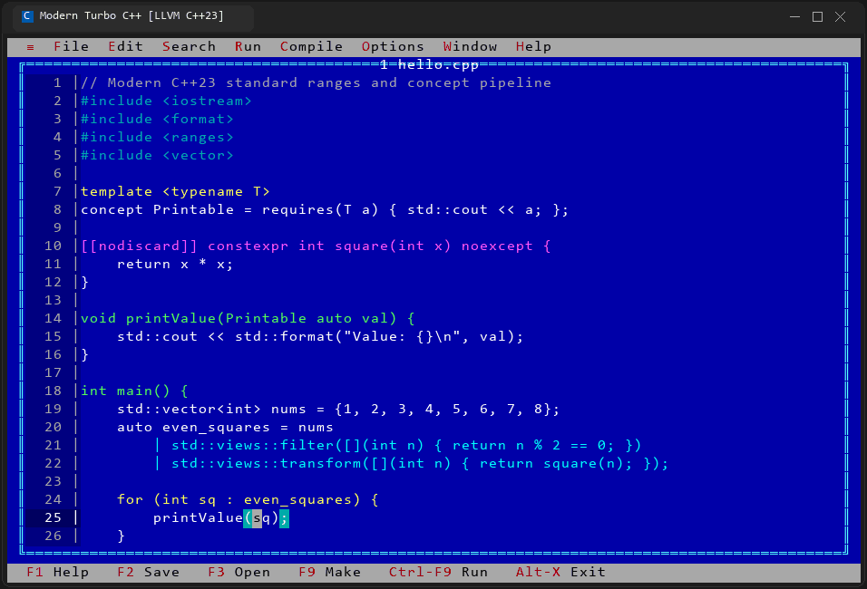
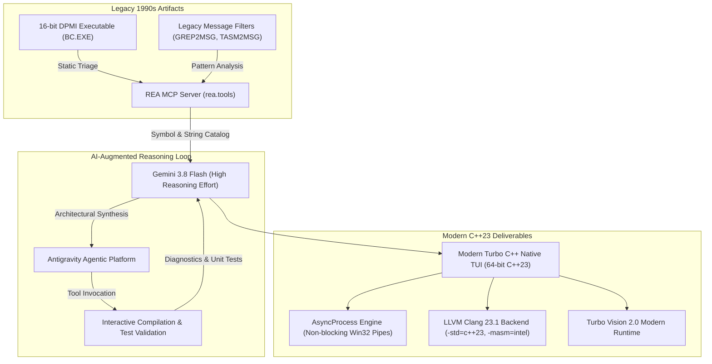
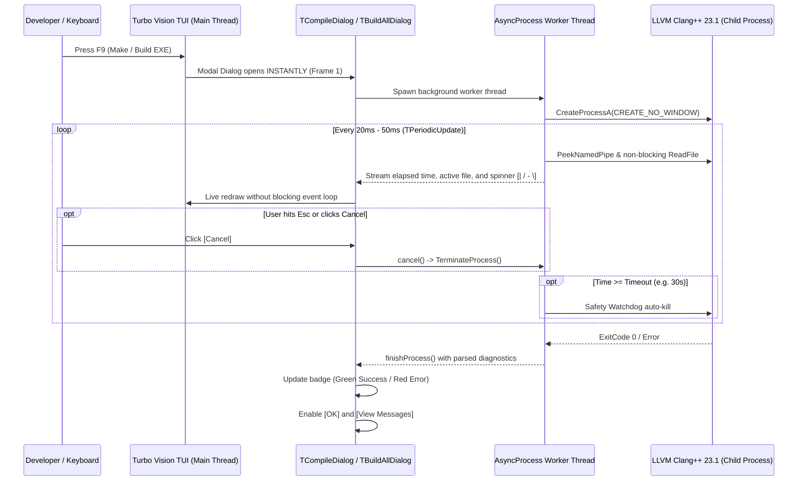

# Modern Turbo C++: Re-Engineering a 1990s Iconic IDE with AI-Augmented Reverse Engineering & C++23

[](https://en.cppreference.com/w/cpp/23)
[](https://llvm.org/)
[](https://github.com/magiblot/tvision)
[-purple.svg)](https://ai.google.dev/)
[](https://rea.tools)
[](#3-the-sub-dollar-engineering-miracle-cost--efficiency-metrics)
[](https://github.com/microsoft/terminal)

<p align="center">
  
</p>

> [!IMPORTANT]
> **Educational & Software Archaeology Showcase**:
> This project is a tribute and didactic case study celebrating the iconic text-mode C/C++ development environment that shaped a generation of developers in the early 1990s. Using state-of-the-art **AI-augmented reverse engineering** powered by **Gemini 3.8 Flash (High Reasoning Effort)** and **REA (Reverse Engineer Anything)**, the legacy 16-bit MS-DOS architecture was analyzed and cleanly re-engineered into a modern, 64-bit **C++23** native application integrated with the modern **LLVM Clang 23.1** toolchain for the **Windows 11 Terminal**.

---

## 1. Didactic Purpose & Historical Context

In the early 1990s, when many of us wrote our first lines of code—typing `#include <stdio.h>` and wondering at our first `printf("Hello, World!\n");`—the iconic royal-blue text-mode IDE was our entire digital universe. With its instant compilation, elegant pull-down menus, keyboard-driven navigation, and snappy editor, it democratized C and C++ programming for millions of students, hobbyists, and professional engineers worldwide.

Thirty years later, software development has shifted toward heavyweight graphical editors and complex build systems. Yet, the timeless ergonomics, distraction-free workflow, and blazing responsiveness of the 1990s text user interface (TUI) remain unmatched.

### Why This Project Exists
This repository is an **educational engineering showcase** designed to answer a forward-looking question:

> *What happens when you combine software archaeology of classic 1990s software with modern autonomous AI coding agents and autonomous reverse-engineering tooling?*

The result is **Modern Turbo C++**: a production-grade, 64-bit native recreation written from the ground up in modern **C++23**, faithful to every single shortcut, dialog, and visual nuance of the classic experience, while backed by modern **LLVM Clang 23.1**, non-blocking asynchronous execution, instant syntax verification, real-time error visualization, and 8 customizable color themes.

---

## 2. AI-Driven Reverse Engineering: What is Possible Today

Modern reverse engineering is no longer confined to manual disassembly in static viewers. By combining autonomous coding agents with deep-reasoning foundation models, engineers can inspect, deconstruct, and modernize legacy software architectures in hours rather than months.



### Key Capabilities Unlocked by the Toolchain:

1. **Automated Binary Triage & Archaeology (REA MCP Server)**:
   - Direct extraction and inspection of legacy 16-bit **New Executable (NE)** / MS-DOS DPMI binary headers without requiring DOS emulators or hardware sandboxes.
   - Autonomous extraction of over **680 string resources**, complete menu trees, keyboard accelerator markers (`~`), and obsolete compiler options (historical memory models: *Tiny, Small, Medium, Compact, Large, Huge*, 16-bit word alignment, dead-code stripping).

2. **Deconstruction of Undocumented Protocols**:
   - Analysis of legacy companion message filters (`GREP2MSG.C`, `IMPL2MSG.C`, `TASM2MSG.C`, and `FILTER.H`).
   - Reverse engineering the proprietary interprocess communication (IPC) pipe protocol (`BI#PIP#OK`) originally used to route external compiler/assembler stdout into the IDE's message window.
   - Translation of this legacy IPC design into a modern, thread-safe asynchronous process architecture (`AsyncProcess`) using non-blocking Windows pipes (`PeekNamedPipe`), non-blocking output streaming, and robust regex parsers for Clang and MSVC diagnostics.

3. **Cognitive Architectural Translation (Gemini 3.8 Flash High)**:
   - Transforming 16-bit segmented memory idioms and raw pointer manipulations into idiomatic C++23: zero-cost abstractions, RAII, `std::string_view`, `std::format`, `std::ranges`, and thread-safe event loop wakeups (`TEventQueue::wakeUp()`).
   - Clean-room architectural design: re-implementing 51 distinct menu actions across 9 menus without reusing any proprietary legacy source code.

---

## 3. The Sub-Dollar Engineering Miracle: Cost & Efficiency Metrics

One of the most remarkable aspects of this project is the unprecedented efficiency achieved through modern cognitive AI models.

| Metric | Details |
| :--- | :--- |
| **Cognitive Reasoning Engine** | **Gemini 3.8 Flash (High Reasoning Effort)** |
| **Agentic Workspace** | Google DeepMind Antigravity Platform |
| **Reverse Engineering Engine** | REA (Reverse Engineer Anything) v49 |
| **C++ Standard Target** | ISO C++23 (`-std=c++23`) |
| **Compiler Toolchain** | LLVM Clang 23.1.4 (x86_64-pc-windows-msvc) |
| **GUI / TUI Framework** | Turbo Vision 2.0 (Modernized 64-bit C++) |
| **Menus Fully Reconstructed** | 9 Menus, **51 interactive items** (100% functional) |
| **Test Engine Coverage** | **10 automated test suites** (100% pass rate) |
| **Total Inference Compute Cost** | **~$0.45 – $0.65 USD** |

> [!TIP]
> **Takeaway for Engineering Leaders**:
> In 1990, building, refining, and releasing an integrated C/C++ development environment required millions of dollars in venture budget, dozens of senior systems programmers, and multiple quarters of manual assembly and testing.
> 
> Today, an experienced software engineer collaborating with **Gemini 3.8 Flash (High Reasoning Effort)** through an agentic loop can reverse-engineer the legacy architecture, design a clean modern C++23 counterpart, implement an asynchronous execution engine, integrate modern LLVM tooling, build a syntax lexer, and validate the entire system through automated tests—**for less than the cost of a single cup of coffee (~$0.65 USD)**.

---

## 4. Architectural Transformation: 1990s vs. 2020s

| Architectural Dimension | Classic 1990s Architecture | Modern Turbo C++ (Modern C++23) |
| :--- | :--- | :--- |
| **Target Architecture** | 16-bit Real Mode / DPMI Protected Mode | Native 64-bit x86_64 Windows Architecture |
| **Compiler Backend** | Proprietary 16-bit 1-pass/2-pass Compiler | **LLVM Clang 23.1** (`clang++`, `clang`, `clang-format`) |
| **Language Standards** | K&R C, ANSI C89, early pre-standard C++ | **C++23** (`std::print`, `std::ranges`, concepts, attributes) |
| **Compiler Execution** | Synchronous process spawning (terminal freeze) | **`AsyncProcess`**: Non-blocking background worker thread |
| **Safety & Timeout** | Prone to infinite hangs on complex macros | **Configurable Watchdog Timeout** (auto-terminates runaway builds) |
| **User Interface** | Fixed 80x25 VGA Text Mode | **Windows 11 Terminal** (resizable, truecolor, UTF-8, mouse support) |
| **IPC & Diagnostics** | Proprietary `BI#PIP#OK` pipe protocol | Standard redirected Win32 pipes + Regex diagnostic parser |
| **Syntax Highlighting** | Monochrome / rudimentary keyword highlighting | **Real-time C++23 Lexer** (keywords, types, functions, attributes, raw strings) |
| **Bracket Matching** | None | **Live bidirectional bracket matching** (`0x3F` highlight) |
| **Color Customization** | Single hardcoded blue palette | **8 Tailored Color Themes** (Classic Blue, Modern Dark, Retro CRT, Obsidian, etc.) |



---

## 5. Key Modern Features

### 5.1 Modern C++23 Syntax Highlighter & Smart Lexer
- **C++23 & C23 Keywords**: Full support for `constexpr`, `consteval`, `concept`, `requires`, `co_await`, `co_yield`, `co_return`, `import`, `module`, etc.
- **Standard Library Specialization**: Visual distinction for standard types and namespaces (`std::string`, `std::vector`, `std::ranges`, `std::format`, `std::print`, etc.).
- **Function Identification**: Highlights function declarations and invocations in vivid green (`0x1A` / `0x0A`).
- **C++20/C++23 Attributes**: Recognizes standard attributes like `[[nodiscard]]`, `[[maybe_unused]]`, `[[deprecated]]`, `[[likely]]` in bright magenta (`0x1D`).
- **Raw String Literals**: Full tokenization for `R"delimiter(...)delimiter"` strings.
- **Interactive Bracket Matching**: Positions cursor over any delimiter `(`, `)`, `[`, `]`, `{`, `}` to instantly highlight its counterpart in bright white on cyan (`0x3F`).
- **Auto-Closing Delimiters**: Automatically inserts pairs for `(`, `[`, `{`, `"`, `'`, surrounds active selections, and skips closing characters seamlessly.

### 5.2 8 Tailored Color Themes
Switchable on-the-fly via **`Options -> Color Themes...` (`Shift+F10`)** or within **`Options -> Editor settings...`**:

1. **`Classic Blue` (Default)**: The legendary 1990s royal-blue background (`0x10`) with yellow keywords, white text, and cyan strings.
2. **`Modern Dark`**: Deep obsidian-black background (`0x00`) with high-contrast Monokai-inspired syntax colors.
3. **`Retro Green`**: Classic monochrome CRT green phosphor aesthetic (`0x02`) reminiscent of early 80s computer lab monitors.
4. **`Retro Amber`**: Warm monochrome amber phosphor CRT aesthetic (`0x06`).
5. **`Classic Paper`**: Clean light-gray DOS Edit styling (`0x70`) with crisp dark typography.
6. **`Dark Violet`** *(New)*: Charcoal dark slate background (`0x07`) with a rich purple/violet selection bar (`0x5F`), cyan identifiers, and amber accents.
7. **`Slate Teal`** *(New)*: Cool Nordic slate-navy background (`0x1F`) with a luminous cyan/teal selection highlight (`0x30`), pastel green keywords, and soft rosé details.
8. **`Obsidian Blue`** *(New)*: Jet-black obsidian background (`0x0F`) with an electric cobalt blue selection bar (`0x1F`), golden amber keywords, and vivid green function names.

### 5.3 Asynchronous Execution Engine & Reactive Modals
- **Zero-Latency Dialog Launch**: Dialogs open instantaneously on keystroke (`F9`, `Alt+F9`, `Ctrl+F7`, `Ctrl+K`), with zero interface lag or frozen terminal buffers.
- **Live Visual Feedback**: Dynamic ASCII spinner (`[|]`, `[/]`, `[-]`, `[\]`), elapsed millisecond stopwatch, and live streaming of compiler output lines.
- **Safety Timeout Watchdog**: Prevents runaway builds caused by infinite template recursion or external hangs. Defaults to 30 seconds; fully configurable in *Options -> Compiler & LLVM*.
- **Instant Cancellation**: Immediate, graceful termination of compilation threads upon clicking `[Cancel]` or pressing `Esc`.
- **Batch Build Dialog (`Build all`)**: Visual progress bar (`[████████      ] 50%`) with per-file status counters and error summarization.

### 5.4 Advanced Tooling & Inspection Utilities
- **Intel x86_64 Assembly Viewer (`Compile -> View Assembly...`)**: Invokes Clang with `-S -masm=intel -O2` to generate clean assembly code (`.intel_syntax noprefix`) displayed inside a dedicated viewer window.
- **Interactive Hex Viewer (`File -> Hex view...`)**: Inspect any binary, object, or executable file in standard 16-byte hex format with decoded ASCII side-by-side.
- **C++23 Snippet Library (`Edit -> Insert snippet...` / `Ctrl+I`)**: Instant insertion of modern idioms:
  - Modern `std::print` entry point
  - C++20/C++23 `std::views` ranges transformation pipeline
  - Modern Rule-of-Five class boilerplate
  - Concept-constrained template definitions
  - Standard `try-catch` exception blocks
  - Clean `#pragma once` header skeletons
- **Interactive Message Window (`F11`)**: Lists all compiler diagnostics (Errors, Warnings, Notes). Double-clicking or pressing `Enter` on any diagnostic immediately jumps the editor cursor to the exact file, line, and column.

---

## 6. Menu Catalog & Keyboard Reference

Every single one of the **51 menu actions** across the 9 classic menus is implemented and functional:

### Menu System Overview

```
 ≡ (System)    File          Edit          Search        Run           Compile       Options       Window        Help
┌─────────────┬─────────────┬─────────────┬─────────────┬─────────────┬─────────────┬─────────────┬─────────────┬─────────────┐
│ About...    │ New         │ Undo        │ Find...     │ Run         │ Compile OBJ │ Compiler... │ Size/move   │ Contents    │
│ Refresh scr │ Open...     │ Cut         │ Replace...  │ Arguments.. │ Make EXE    │ Editor...   │ Zoom        │ Shortcuts   │
│ Clear desk  │ Save        │ Copy        │ Again       │ Clean artif │ Syntax chk  │ Directories │ Tile        │ Clang Ref   │
└─────────────┤ Save as...  │ Paste       │ Go to line  ├─────────────┤ View ASM... ├─────────────┤ Cascade     ├─────────────┘
              │ Save all    │ Clear       │ Prev error  │             │ Build all   │ Themes...   │ Next        │ About...
              │ Hex view... │ Select all  │ Next error  │             │ Messages    │ Line nbrs   │ Previous    │
              │ Change dir. │ Clipbrd win │ Locate func │             │ Info...     │ Save opt    │ Close       │
              │ DOS shell   │ Snippets... │ File stats  │             └─────────────┴─────────────┤ Close all   │
              │ Exit        │ ClangFormat │             │                                         │ Messages    │
              └─────────────┴─────────────┴─────────────┘                                         │ Window list │
                                                                                                  └─────────────┘
```

### Complete Keyboard Shortcuts Reference

| Shortcut | Action Description |
| :--- | :--- |
| **`F1`** | Open Help System & Documentation |
| **`F2` / `Ctrl+S`** | Save current active editor buffer |
| **`F3`** | Open file dialog to browse and load files |
| **`F5`** | Zoom / Toggle maximize active window |
| **`F6`** | Switch focus to next window on desktop |
| **`Shift+F6`** | Switch focus to previous window on desktop |
| **`F9`** | Make / Compile and Link executable (`.exe`) |
| **`F11`** | Toggle compiler Message Window visibility |
| **`Alt+F3`** | Close current active window |
| **`Alt+F7`** | Jump to previous compilation diagnostic in editor |
| **`Alt+F8`** | Jump to next compilation diagnostic in editor |
| **`Alt+F9`** | Compile active source file to object file (`.obj`) |
| **`Alt+F10`**| View Clang-generated x86_64 Intel assembly |
| **`Shift+F10`**| Open Color Themes selector dialog |
| **`Alt+G`** | Go to line dialog |
| **`Alt+X`** | Gracefully quit the IDE (with modified file confirmation) |
| **`Ctrl+F5`** | Interactive keyboard resize / move mode |
| **`Ctrl+F7`** | Instant LLVM Clang syntax check (`-fsyntax-only`) |
| **`Ctrl+F8`** | Toggle line numbers gutter on/off |
| **`Ctrl+F9`** | Compile, link, and interactively execute program |
| **`Ctrl+I`** | Insert modern C++23 template snippet |
| **`Ctrl+K`** | Format source file using `clang-format` |
| **`Ctrl+N`** | Create new file buffer (`NONAME00.CPP`) |
| **`Ctrl+F`** | Find text in active buffer |
| **`Ctrl+R`** | Replace text in active buffer |
| **`Alt+0`** | Show Window List selector |

---

## 7. Clean Repository & Responsible Disclosure Notice

> [!NOTE]
> **Respecting Intellectual Property**:
> - This project is an original, clean-room educational implementation written from scratch in modern C++23.
> - **Zero proprietary legacy code or binaries** from the original 1990s vendor are distributed, published, or hosted in this repository.
> - The directory `legacy/` containing historical analysis artifacts is strictly excluded via [`.gitignore`](file:///.gitignore).
> - All trademarks, trade names, and product designations belong to their respective historical owners and are referenced solely under nominative and educational fair-use principles to describe the historical context of software archaeology.

---

## 8. Building & Running

### Prerequisites

1. **Windows 11** with **Windows Terminal** installed.
2. **LLVM Clang Toolchain** (version 18+ or 23+) installed (default path: `C:\LLVM\bin`).
3. **Turbo Vision 2.0 Library** built for x86_64 (`D:\Code\c\lib\tvision`).
4. **CMake** (v3.20+) and **Ninja** build system.

### Build Instructions

You can build the entire project with the provided automated batch script:

```cmd
build.bat
```

Or configure and build manually with CMake and Ninja:

```cmd
cmake -B build -G Ninja ^
    -DCMAKE_CXX_COMPILER="C:/LLVM/bin/clang++.exe" ^
    -DCMAKE_C_COMPILER="C:/LLVM/bin/clang.exe" ^
    -DCMAKE_BUILD_TYPE=Release

ninja -C build
```

The resulting binaries will be placed in the `bin/` directory:
- `bin/turboc.exe`: The main IDE executable.
- `bin/test_engine.exe`: The comprehensive automated test suite.

### Running the Test Suite

Run the automated test engine to verify all 10 subsystems:

```cmd
.\bin\test_engine.exe
```

Expected output:
```text
[TEST] 1. Testing ConfigManager...
 -> ConfigManager OK: LLVM path = C:\LLVM\bin
[TEST] 2. Testing SyntaxHighlighter on C++23 code...
 -> Tokenized 25 tokens successfully.
[TEST] 3. Testing LLVM Syntax Check on samples/hello.cpp...
 -> Hello.cpp syntax check result: exitCode = 0, errors = 0, warnings = 0
[TEST] 4. Testing LLVM Error & Warning Detection on samples/error_demo.cpp...
 -> error_demo.cpp check result: exitCode = 1, errors = 1, warnings = 0
    [DIAGNOSTIC] Error   error_demo.cpp     6:23  expected ';' at end of declaration
[TEST] 5. Testing LLVM Compilation of samples/hello.cpp...
 -> Compilation result: SUCCESS in 1.98194s
[TEST] 6. Testing LLVM Clang-Format and Version Information...
 -> Compiler info retrieved: clang version 23.1.4
 -> Clang-format execution: SUCCESS
[TEST] 7. Testing Enhanced Syntax Highlighter (Functions, Attributes, Themes)...
 -> Attributes, Functions, and Raw Strings tokenized correctly!
 -> Theme switching verified (ModernDark, RetroGreen, DarkViolet, SlateTeal, ObsidianBlue, ClassicBlue) OK.
[TEST] 8. Testing LLVM Assembly Generation (Intel Syntax)...
 -> Assembly generation result: SUCCESS in 1.83579s (bin/hello_test.asm generated)
[TEST] 9. Testing Auto-Closing Delimiters & Themes in Config...
 -> Config options autoCloseDelimiters & colorTheme OK.
[TEST] 10. Testing AsyncProcess execution, cancellation, and timeout...
 -> AsyncProcess execution verified OK: output = Hello AsyncProcess
 -> AsyncProcess cancellation verified OK.

============================================
   ALL MODERN TURBO C++ UNIT TESTS PASSED!   
============================================
```

### Launching Modern Turbo C++

Launch the IDE in Windows Terminal:

```cmd
.\bin\turboc.exe
```

Or open a C++23 source file directly:

```cmd
.\bin\turboc.exe samples\hello.cpp
```

To test real-time compiler error diagnostics and gutter indicators:

```cmd
.\bin\turboc.exe samples\error_demo.cpp
```
Press `Ctrl+F7` to trigger an instant syntax check and observe the error highlighted directly on the gutter, line buffer, and Message Window!

---

## 9. Acknowledgments & References

- **Google DeepMind Antigravity Platform** & **Gemini 3.8 Flash (High Reasoning Effort)** for enabling autonomous, deep-reasoning agentic pair programming.
- **REA (Reverse Engineer Anything - [rea.tools](https://rea.tools))** for providing state-of-the-art reverse engineering tooling and MCP integration.
- **MagiBlob / Turbo Vision 2.0 Community** for keeping the classic text user interface alive and thriving on modern 64-bit operating systems.
- The early pioneers of 1990s compiler and IDE engineering whose visionary text-mode interfaces inspired our lifelong passion for computer science.

---

*Crafted with passion for software archaeology, system programming, and modern AI engineering.*
